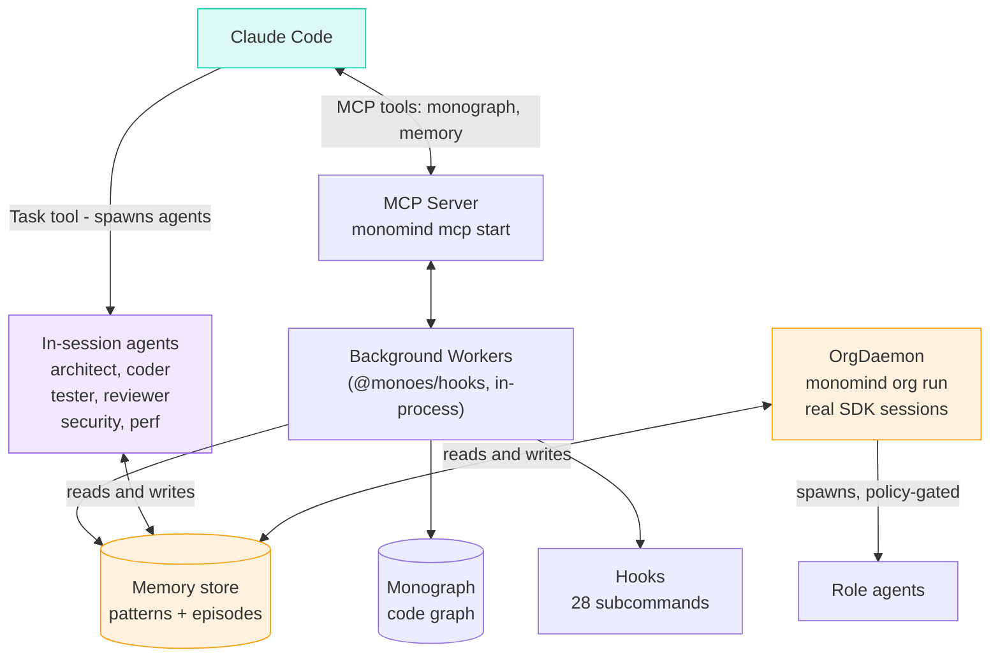

# Getting Started with Monomind

> **5-minute guide** — install, connect, and run your first command.

## What is monomind?

Monomind extends AI coding assistants (Claude Code, Antigravity, OpenCode, Kimi Code, and Codex) with four local-first capabilities:

1. **Monograph** — a code knowledge graph (14 tree-sitter grammars + 5 regex-fallback languages — see `packages/@monomind/monograph/README.md` for the authoritative count — plus SQLite + BM25)
2. **Memory** — persistent memory across sessions (SQLite + local embeddings + keyword fallback)
3. **Second Brain** — document RAG (PDF/Office/EPUB ingestion, semantic search, eval-gated)
4. **Org Runtime** — multi-agent daemon with dashboard, governance, and budgets

Monomind itself runs locally and keeps its state (memory, code graph, document index, org state) on your machine, with local embeddings — no cloud embedding service or extra API key is needed. The AI tool it extends still sends your prompts and code, including memory and Second Brain excerpts injected into them, to its model provider; see [doc/privacy.md](privacy.md) for monomind's own outbound requests.

## Step 1: Install

```bash
npm install -g monomind
```

Verify:

```bash
monomind --version
```

## Step 2: Initialize your project

```bash
cd your-project
monomind init
```

This sets up the coding systems installed on your machine, out of Claude Code, Antigravity, OpenCode, Kimi Code, and Codex, plus any of them the project already has. A system counts as installed when its CLI is on your `PATH` (`claude`, `gemini`/`agy`/`antigravity`, `opencode`, `kimi`, `codex`) or its config directory exists (`~/.claude` or `$CLAUDE_CONFIG_DIR`, `~/.gemini` or `~/.antigravity`, `~/.config/opencode`, `$XDG_CONFIG_HOME/opencode` or `~/.opencode`, `~/.kimi` or `~/.kimi-code`, `~/.codex` or `$CODEX_HOME`). If none is found, init sets up Claude Code and says so. Init prints what it detected and how to add the others. For each system it writes the native instructions/configuration, shared skills, and MCP wiring, then builds the initial code graph. It takes 30–60 seconds and spawns a background process for the graph build.

Init never installs anything into your project: your `package.json` and lockfile stay as they are. If Claude Code is selected but its CLI is missing, init asks whether to install it globally (`npm install -g @anthropic-ai/claude-code`), and only in an interactive terminal; otherwise it prints that command. `--no-install` turns the question off. The code graph is built with the copy of `@monoes/monograph` that ships with the monomind CLI, and the hooks find that same copy (or a global install) later.

To choose the systems yourself:

```bash
monomind init --platforms claude,codex   # exactly these, installed or not
monomind init --all-platforms            # all five platforms (same as --target all)
```

`--full` also writes all five, along with every component and pack. `monomind init wizard` asks the same question, with the detected systems pre-selected (all five for the Full preset). Re-running `monomind init --yes` (or `--force`, which also refreshes the managed files) keeps every system the project already has, so it re-pins their MCP entries after an upgrade. `monomind init upgrade` refreshes the Claude Code helpers, statusline and CLAUDE.md, and with `--add-missing` copies new skills into `.gemini/` and `.agents/` only if the project has them; it does not refresh `.codex/`, `opencode.json`/`.opencode/` or `.kimi-code/`, and never adds a system. To add one later, run `monomind init --platforms claude,codex --yes`.

Init also sets up the memory database (`.swarm/memory.db`, the same one `monomind memory init` creates, copied to `.claude/memory.db`), so `monomind doctor` reports **Memory Database ✓** straight away. Re-running init keeps an existing database and everything in it. Pass `--no-memory` to skip it; `--only-claude` skips it too, since that mode writes no runtime state, and `--skip-claude` creates the database without the `.claude/` copy. If the database can't be created (for example, `sql.js` is missing), init still finishes and prints a warning: run `monomind memory init` to retry.

To initialize only one system, you can also use `--target`:

```bash
monomind init --target codex
monomind init --target opencode
monomind init --target kimicode
monomind init --target antigravity
monomind init --target claude
```

The legacy `--codex`, `--opencode`, and `--kimicode` flags remain aliases for their corresponding single targets.

**Headless / scripted init (coder workspaces, mono-agent, CI):**

```bash
monomind init --project ./some/other/dir --if-missing --json --yes --no-watch --no-install --no-graph
```

- `--project <dir>` initializes `<dir>` instead of the cwd.
- `--if-missing` creates only files that don't exist yet — safe to run against a repo you already
  hand-configured; it never touches an existing `CLAUDE.md`, `AGENTS.md`, `.claude/settings.json`,
  or `.mcp.json`, and a second run creates nothing.
- `--json` prints one machine-readable result on stdout
  (`{root, created, skipped, claude_project_registered, duration_ms}`) with no prompts or spinner.
- `--no-graph` skips the Monograph code-graph build for a faster, few-second init.

Full contract: `doc/agent-exec-protocol.md` §11 (capability `init-json`).

**Claude Code Agent Teams are opt-in.** `init` and `init upgrade` do not write `CLAUDE_CODE_EXPERIMENTAL_AGENT_TEAMS` or the `monomind.agentTeams` settings block, because nothing in Monomind reads them and teammate messages add background token use. Pass `monomind init --agent-teams` if you want them. `monomind doctor` reports a leftover flag or block, and `monomind init upgrade --settings` removes the ones an earlier `init` wrote.

**Optional — power-user setup:**

```bash
monomind init wizard
```

The wizard asks about topology, memory backend, embeddings model, etc. Most users should stick with the defaults from plain `monomind init`.

## Step 3: Register the MCP server

```bash
claude mcp add monomind -- npx -y monomind@latest mcp start
```

`monomind init` already wrote `.mcp.json` for the project, so this step is only needed to register the server outside that file (for example at user scope). It tells Claude Code how to reach monomind's MCP tools. The generated Codex, OpenCode, Kimi Code, and Antigravity configurations register the same local server using each platform's native format.

`init` pins the MCP entries it generates (`.mcp.json`, Codex, OpenCode, Kimi Code, Antigravity) to the monomind version that ran it: `npx -y --package=@monoes/monomindcli@<version> monomind mcp start`. A floating `@latest` re-resolves the npm dist-tag on every start (3–4 s), can hang on a cold npx cache, and can change version mid-session. Pass `--pin latest` (or `--no-pin`) to keep `monomind@latest`, or `--pin <version>` for another version; after upgrading monomind, run `monomind init --force` to re-pin (`monomind update` does not rewrite these configs).

## Step 4: Verify the install

```bash
monomind mcp verify
```

You should see:

```
✓ Tool registry: 21 tools registered
✓ Sample tool (system_info): resolves
✓ claude mcp registration: monomind appears in `claude mcp list`
```

If any check fails, the output tells you exactly what to fix.

## Step 5: Use it in Claude Code

Open Claude Code in your project. Type:

```
/mastermind:help
```

This lists all available slash commands. The most useful starting points:

| Command | What it does |
|---|---|
| `/mastermind:understand` | Analyze your project with an LLM and enrich the knowledge graph (extras pack: `monomind packs add extras`) |
| `/mastermind:debug` | Systematic root-cause debugging protocol |
| `/mastermind:plan` | Write a comprehensive implementation plan before touching code |
| `/mastermind:review` | Review the work and auto-fix findings; add `--tillend` to loop until a round comes back clean |

### Agents and skills

By default, `monomind init` installs the core pack: <!-- doc-count:installed-agents -->20<!-- /doc-count:installed-agents --> agents under `.claude/agents`, the everyday skills under `.claude/skills` and slash commands under `.claude/commands`. You rarely name one yourself: for each prompt, the hook adds a line such as

```
[PICK] agent: Security Engineer · skill: /mastermind:review
```

to Claude's context when one agent or skill clearly fits, and Claude uses it. To see the ranking for any task, run `monomind pick -t "<task>"`. Your own agents and skills are Markdown files in the same folders; [Agents & Skills](concepts/agents-and-skills.md) shows where each kind goes and what to put in its frontmatter.

### Packs

Claude Code lists every installed skill and command with its description, and once that list passes about 1% of the context window it drops descriptions. So `monomind init` installs only the **core** pack; the rest are opt-in:

| Pack | What it adds |
|---|---|
| `orgs` | Agent orgs: create, run, stop and inspect them; org tasks, goals and routines |
| `org-admin` | Org admin bookkeeping: access, invites, plugins, adapters, secrets, backups |
| `swarm` | Hooks and workflow commands; consensus and optimization agents |
| `github` | GitHub commands and agents: repo architecture, multi-repo sync, project boards, Actions |
| `testing` | QA agents: API, accessibility, evidence collection, test analysis |
| `specialists` | Specialist agents: data, SRE, mobile, embedded, Solidity, WeChat, Feishu, MCP |
| `business` | Marketing, sales, finance, content and ops workflows; marketing agents |
| `extras` | Pair programming, monograph commands, monolean audits, skill builders, jj |

```bash
monomind packs list                    # every pack, installed or not, and its listing size
monomind packs add orgs github         # add packs to this project
monomind packs remove business         # remove a pack (files you changed are kept)
monomind init --packs orgs,github      # or choose at init time; --all-packs installs everything
```

The wizard (`monomind init wizard`) asks which packs to add. A project initialised before packs existed keeps everything it has: `init` and `init upgrade` never delete a skill, command or agent, and `init upgrade --add-missing` only adds files for the packs the project has. `packs remove` deletes only files that still match what init installed.

## What's running?

| Component | How to check | How to stop |
|---|---|---|
| Code graph (Monograph) | `monomind monograph stats` | Automatic (background build) |
| Memory | `monomind memory list` | Always on (SQLite) |
| MCP server | `monomind mcp status` | `monomind mcp stop` |
| Dashboard | `curl -s http://localhost:4242/api/identity` | `node .claude/helpers/control-stop.cjs` |
| Org daemon | `monomind org status` | `monomind org stop <name>` |

### The dashboard

The dashboard (Control Room, `http://localhost:4242`) does not start on its own. Start it when you want it:

```bash
monomind ui                                  # serves on :4242 until Ctrl+C; --no-open skips the browser
curl -s http://localhost:4242/api/identity   # prints its pid and project dir when it is up
```

To have it start at every Claude Code session start in this project, run `monomind init --dashboard` (it writes `{"autostart": true}` to `.monomind/dashboard.json`), or set `MONOMIND_DASHBOARD_AUTOSTART=1` in your environment. `MONOMIND_DASHBOARD_AUTOSTART=0` turns auto-start off even for a project that opted in. An auto-started server keeps running after Claude Code closes; `node .claude/helpers/control-stop.cjs` stops it. While a dashboard is running, the per-prompt Second Brain lookup uses its warm semantic search; without one it falls back to keyword matching.

## Troubleshooting

**`monomind doctor` warns on fresh install** — expected. The doctor checks many categories (`monomind doctor -c <name>` runs one; an unknown name prints the valid ones); on a fresh project, several report "not configured yet." Run `monomind doctor --fix` to auto-resolve what's fixable, or `monomind doctor --verbose` for details.

**Embedding model download** — the first `monomind doc ingest` fetches a ~90 MB model from HuggingFace. If offline, search degrades gracefully to keyword matching. It is not the only outbound request monomind makes — see [doc/privacy.md](privacy.md) for the full list (update checks, `doctor`, crash reporting, etc.) and how to opt out of each.

**Token costs add up faster than you expect** — `monomind doctor -c cost-settings` is a read-only check for Claude settings that multiply token use: a `CLAUDE_CODE_EFFORT_LEVEL` that overrides your `/effort` choice, a very large compaction window, tool search turned off, a high output cap, or the same hook registered twice. See [Hooks](concepts/hooks.md#token-cost-settings-check).

**Cost of `org run`** — running an org daemon spends real provider tokens. Always use `--dry-run` first to preview, and `--budget-usd` to set a hard limit:

```bash
monomind org run my-team --dry-run          # preview without spending
monomind org run my-team --budget-usd 5     # hard-stop at $5
```

## Next steps

- `doc/concepts/agents-and-skills.md` — where agents, skills and Org skills live, and how to add your own
- `doc/concepts/routing.md` — how the agent and skill picker works
- `doc/concepts/monograph.md` — how the code graph works
- `doc/concepts/memory.md` — memory tiers and search
- `doc/concepts/org-runtime.md` — multi-agent daemon

---

## Init details and platform guides (moved from the README)

`monomind init` installs the **core pack**: the everyday `/mastermind:*` workflows (plan, execute, review, debug, do, …), 20 core agents and the memory, GitHub and browser toolkits, small enough that Claude Code shows every description. Everything else ships as opt-in packs (`orgs`, `org-admin`, `swarm`, `github`, `testing`, `specialists`, `business`, `extras`): pick them with `monomind init --packs orgs,github` or `--all-packs`, or add one later with `monomind packs add <pack>`. `monomind packs list` shows each pack and how much of the listing it uses.

Org skills come from the bundled library, from your own Markdown files, and from imports: `monomind org skills import` pulls MIT or Apache-2.0 skills from another repo and records the licence, source and commit on each one (the library includes a bundle from `anthropics/knowledge-work-plugins`). For skills you want reviewed before roles can use them, `monomind catalog` stages, approves and activates them under a policy ([Catalog](concepts/catalog.md)).

`monomind init` sets up only the coding systems installed on your machine: Claude Code, Antigravity, OpenCode, Kimi Code and Codex each count when their CLI is on your `PATH` or their config directory is in your home, and Claude Code is the default when none is found. A re-run also keeps every system the project already has. It prints what it detected; `--platforms claude,codex` names the systems yourself and `--all-platforms` writes all five. It never runs `npm install` or edits your `package.json`: the code graph uses the `@monoes/monograph` copy bundled with the CLI.

Two things `init` leaves off unless you ask: Claude Code's experimental Agent Teams (`--agent-teams` writes `CLAUDE_CODE_EXPERIMENTAL_AGENT_TEAMS=1`; nothing in Monomind reads it) and dashboard auto-start at every session (`--dashboard`). `monomind doctor` reports a leftover Agent Teams flag from an older `init`, and `monomind init upgrade --settings` removes it (a backup stays in `settings.json.bak-agent-teams`).

`init` writes `.mcp.json` (and the other systems' configs) pinned to the installed version; `--pin latest` keeps the floating `monomind@latest`, and `monomind init --force` re-pins after an upgrade.

<details>
<summary><strong>Using Antigravity (agy)?</strong></summary>

Nothing extra to do when Antigravity is installed (`agy`/`gemini` on PATH or `~/.gemini`): `monomind init` then writes `GEMINI.md`, `.gemini/rules/`, and a live status bar wired through `.gemini/settings.json`. The MCP server config is shared with Claude Code (`.mcp.json`). See [Antigravity guide →](concepts/antigravity.md).

</details>

<details>
<summary><strong>Using opencode instead?</strong></summary>

```bash
monomind init --target opencode # initialize only OpenCode
```

`monomind init` sets up the coding systems it detects on your machine (CLI on PATH or config directory in your home), OpenCode included when it is installed. `--target opencode` initializes only OpenCode; the legacy `--opencode` flag remains an alias. You get the same MCP tools, agent roster, commands, skills, and security gates, plus a `/monomind-status` command. See [OpenCode guide →](concepts/opencode.md).

</details>

<details>
<summary><strong>Using Kimi Code instead?</strong></summary>

```bash
monomind init --target kimicode # initialize only Kimi Code
```

`monomind init` includes Kimi Code when it is installed (`kimi` on PATH or `~/.kimi`). `--target kimicode` initializes only Kimi Code; the legacy `--kimicode` flag remains an alias. You get the same MCP tools, agent roster, skills, and commands (as project-level flow skills). Install the generated plugin once for `/monomind:*` slash commands and security gates: `/plugins install ./.kimi-code/plugin`. See [Kimi Code guide →](concepts/kimicode.md).

</details>

<details>
<summary><strong>Using Codex?</strong></summary>

```bash
codex login
monomind init --codex
```

This emits a project-scoped `.codex/config.toml` that registers Monomind's MCP
server, plus `AGENTS.md` with Codex-specific guidance. Codex must trust the
project before it loads project-scoped configuration. To run persistent
Monomind organizations through Codex, set `"runtime": "codex"` in the org
definition.

Use `monomind init --target codex` (or `--codex`) to initialize only Codex. See [Codex guide →](concepts/codex.md).

</details>

### Install notes

`monomind doctor` also reports Token Cost Settings (an effort env var overriding `effortLevel`, a huge compaction window, tool search off, duplicate hooks). `doctor --json` prints every check for programs to read, and `--read-only` / `--offline` keep it from changing files or using the network.

> **Semantic routing (opt-in download):** embedding-based task routing needs a local model (~88 MB, `Snowflake/snowflake-arctic-embed-xs` via transformers.js). `monomind init` asks interactively whether to download it — the default is No, and non-interactive/CI installs never download it silently. Declining is fine: agent picking (`monomind pick`, the `[PICK]` hook line, `hooks route`) never needs the model; only `route semantic`, `hooks_route_semantic` and `agent spawn --task` use it, after the picker, and fall back to keyword and hash matching without it. Fetch it any time with `monomind download-embeddings` (or `node scripts/download-embedding-model.mjs` on a source checkout).

> **Native module install blocked?** If `doctor` reports a missing `better-sqlite3` binding (`Could not locate the bindings file`, or npm logs an install script that was "blocked because it is not covered by allowScripts"), your npm's `allowScripts` policy blocked its native build — this isn't a Monomind bug. Run `npm install-scripts approve better-sqlite3 && npm rebuild better-sqlite3`, then re-run `monomind doctor --fix`.

Open Claude Code. The core `/mastermind:*` workflows are available (all <!-- doc-count:mastermind-commands -->40<!-- /doc-count:mastermind-commands --> come with `monomind packs add` or `init --all-packs`):

```bash
/mastermind:review --tillend      # review and fix until nothing is left
monomind org run sample-team      # run your first AI org (init writes sample-team.json; the first run offers to review and sign it)
/mastermind:help                  # show all commands
```

## How it is built (moved from the README)



The earlier `monoswarm` and `autopilot` commands are gone (removed in 2.22.0); use the Task tool or `monomind org run` instead.

**Claude Code's Task tool drives in-session multi-agent work; `monomind org run` drives persistent background orgs.** Monomind keeps its own state on your machine; the AI tools it drives send prompts and code to their model providers — see [Trust & Security](../README.md#trust--security).
