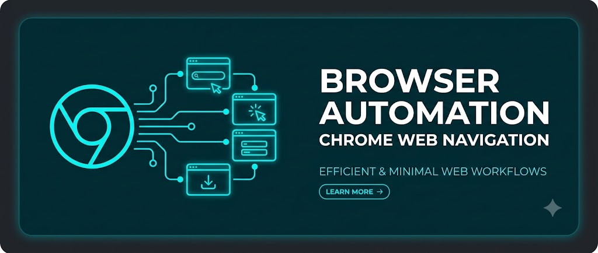

<p align="center">
  
</p>

# @monoes/monobrowse

[](https://www.npmjs.com/package/@monoes/monobrowse)
[](https://github.com/monoes/monomind/blob/main/LICENSE)
[](https://nodejs.org)

**Browser automation via Chrome DevTools Protocol** — navigate, click, fill forms, take screenshots, and evaluate JavaScript in a real Chrome browser. No Puppeteer, no Playwright, no external binaries — just CDP over WebSocket.

> Part of the [Monomind](https://github.com/monoes/monomind) ecosystem. Powers `monomind browse`.

## Install

```bash
npm install @monoes/monobrowse
```

## CLI usage

```bash
# Via monomind
monomind browse open https://example.com
monomind browse snapshot            # list elements with @eN refs
monomind browse screenshot page.png
monomind browse click @e1
monomind browse eval "document.title"
```

## Programmatic usage

```typescript
import { launchBrowser, createBrowserPage } from '@monoes/monobrowse';

const port = await launchBrowser({ headless: true });   // resolves to the CDP port
const page = await createBrowserPage('https://example.com', port);

console.log(await page.url());
console.log(await page.evaluate<string>('document.title'));
await page.close();
```

The package also exports the lower-level building blocks (`CdpClient`, `captureScreenshot`, `clickElement`, `fillElement`, `evaluateJs`, and more) for custom flows.

## Features

- **No browser automation framework** — only `ws` and `commander` as runtime dependencies
- Direct CDP WebSocket connection to Chrome/Chromium
- Navigate, click, type, screenshot, evaluate JS
- Session management for multi-page workflows
- Headless and headed modes

## Why not Puppeteer/Playwright?

Monobrowse talks CDP directly — no 50+ MB framework download, no binary management, no version pinning against Chrome releases. It does what AI agents need (navigate, interact, screenshot, evaluate) without the weight.

## Links

- [GitHub](https://github.com/monoes/monomind)
- [Documentation](https://monoes.github.io/monomind/)
- [Issues](https://github.com/monoes/monomind/issues)

## License

Apache-2.0
