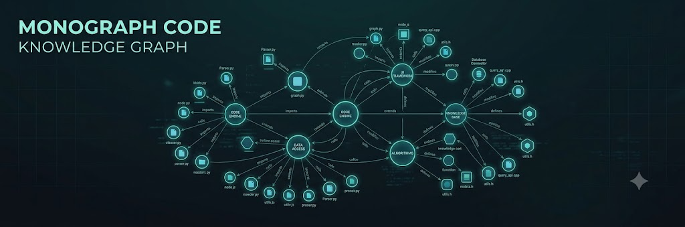

<p align="center">
  
</p>

# @monoes/monograph

[](https://www.npmjs.com/package/@monoes/monograph)
[](https://github.com/monoes/monomind/blob/main/LICENSE)
[](https://nodejs.org)

**Code intelligence as a graph** — tree-sitter parses your codebase into a SQLite-backed knowledge graph of files, functions, classes, imports, and call relationships. Query blast radius, find callers, and navigate architecture without grep.

> Part of the [Monomind](https://github.com/monoes/monomind) ecosystem.

## Install

```bash
npm install @monoes/monograph
```

## What it does

Monograph walks your source tree with [tree-sitter](https://tree-sitter.github.io/tree-sitter/), extracts symbols and their relationships, and stores them in a SQLite database. The result is a queryable graph where:

- **Nodes** are files, functions, classes, methods, and exports
- **Edges** are imports, calls, extends, and contains relationships

## CLI usage

```bash
# Build the graph for the current project
monomind monograph build

# Search the knowledge graph (BM25, semantic, or hybrid)
monomind monograph search -q "authentication flow"

# Show graph statistics
monomind monograph stats

# Embed graph nodes for semantic search
monomind monograph embed

# Watch for changes and rebuild incrementally
monomind monograph watch

# Start the LSP server for editor integration
monomind monograph lsp

# Build a document knowledge graph from docs & PDFs (separate from the code graph above)
monomind monograph wiki
```

> `impact` (blast radius), `god-nodes` (high-centrality files), and freshness/staleness checks have no CLI subcommand — they're MCP-tool-only (`monograph_impact`, `monograph_god_nodes`, `monograph_health`, `monograph_staleness`), see [MCP tools](#mcp-tools) below. `stats` above reports graph size, not freshness — don't confuse the two.

## Programmatic usage

```typescript
import { buildAsync, openDb, queryGraph, getMonographImpact } from '@monoes/monograph';

await buildAsync(process.cwd());

const db = openDb('.monomind/monograph.db');
const results = queryGraph(db, { query: 'authenticate' });
const impact = getMonographImpact(db, { name: 'login', filePath: 'src/auth/login.ts' });
```

## MCP tools

When used via Monomind's MCP server, monograph exposes 20 tools by default (+27 advanced via `MONOGRAPH_MCP_ADVANCED=1`):

| Tool | Purpose |
|---|---|
| `monograph_build` | Build or refresh the graph |
| `monograph_suggest` | Start every task — ranked relevant files |
| `monograph_query` | BM25 keyword search with PPR graph reranking |
| `monograph_brief` | Task text to entry points, covering docs and blast radius |
| `monograph_impact` | Blast radius analysis (upstream + downstream) |
| `monograph_god_nodes` | High-centrality internal files |
| `monograph_context` | 360° view of a file |
| `monograph_neighbors` | Direct neighbors of a node |
| `monograph_stats` | Graph size statistics |
| `monograph_get_node` | Fetch one node by id |
| `monograph_api_impact` | Impact analysis for API changes |
| `monograph_doctor` | Index health diagnostics |
| `monograph_augment` | Graph-RAG context retrieval |
| `monograph_dead_code` | Dead exports, orphan files, stale dist |
| `monograph_detect_changes` | Map git diff to affected graph nodes |
| `monograph_route_map` | List HTTP routes with handlers |
| `monograph_watch` | Start incremental file watcher — rebuilds on file changes |
| `monograph_watch_stop` | Stop the incremental file watcher |
| `monograph_health` | Manual, on-demand staleness check |
| `monograph_staleness` | Staleness check — auto-triggers a background rebuild if >3 commits behind HEAD |

## Supported languages & Parsers

Monograph utilizes a dual-tier parsing strategy for extracting code structure and symbols.

> **This section is the authoritative source for Monograph's language/grammar counts.**
> Other docs in this repo should link here instead of restating the numbers.

1. **Tree-sitter AST Parsers — 14 grammar modules, 25 supported extensions** (WASM, via `web-tree-sitter`; no native build):
   - **Grammar modules** (one `LanguageConfig` each, [`src/parsers/`](src/parsers/)): `c`, `cpp`, `csharp`, `dart`, `go`, `java`, `kotlin`, `php`, `python`, `ruby`, `rust`, `swift`, `typescript`, `vue` — 14 total. (`typescript` also covers JavaScript; there is no separate JS grammar.) The compiled grammars ship in [`wasm/`](wasm/) and are copied into `dist/wasm/` at build time; set `MONOMIND_WASM_DIR` to load them from another directory.
   - **Extensions**: `.ts`, `.tsx`, `.js`, `.jsx`, `.mjs`, `.cjs`, `.py`, `.go`, `.rs`, `.java`, `.c`, `.h`, `.cpp`, `.cc`, `.cxx`, `.hpp`, `.hxx`, `.cs`, `.rb`, `.swift`, `.php`, `.vue`, `.kt`, `.kts`, `.dart` — 25 total, mapped onto the 14 grammar modules above.
   - **Grammar Loader**: Loads and caches grammars per extension via `getParser(ext)` ([`loader.ts`](src/parsers/loader.ts)). `.vue` files always take the `<script>`-block path: the block is extracted and parsed with the TypeScript grammar ([`vue.ts`](src/parsers/vue.ts)).
   - **Validation**: `getParser()` binds each grammar to a fresh `Parser` before trusting it, and records why a grammar failed to load (MEM-2) so `parseFile()` can report a diagnostic instead of silently returning 0 nodes. A failing `dart` grammar falls back to the regex extractor; other languages have no fallback and yield no symbols.
2. **Regex Fallback Parsers (5 languages, 6 including the `dart` fallback when its tree-sitter grammar fails validation)**:
   - Lightweight regex-based symbol extractors used when a language has no tree-sitter grammar or its grammar fails validation: **Scala**, **Lua**, **Zig**, **PowerShell**, **Elixir**, and (fallback-only) **Dart** ([`language-parsers.ts`](src/parsers/language-parsers.ts)).

## SQLite Database Schema

The graph is stored in a WAL-mode SQLite database (`PRAGMA journal_mode = WAL`) managed in [`schema.ts`](src/storage/schema.ts) and [`db.ts`](src/storage/db.ts):

- **`nodes`**: Code symbols and files (`id`, `label`, `name`, `norm_label`, `file_path`, `start_line`, `end_line`, `community_id`, `is_exported`, `language`, `properties`; embeddings live in the separate `node_embeddings` table).
- **`edges`**: Directed relationships between nodes (`id`, `source_id`, `target_id`, `relation`, `confidence`, `confidence_score`, `weight`, `reason`, `evidence`).
- **`communities`**: Hierarchical community clusters (`id`, `label`, `size`, `cohesion_score`).
- **`file_cache`**: SHA-256 incremental parse cache (`file_path`, `content_hash`, `last_parsed`, `node_count`, `edge_count`).
- **`nodes_fts`**: Trigram-tokenized FTS5 virtual table (`tokenize='trigram'`) indexing `name`, `norm_label`, and `file_path` with sync triggers for rapid symbol and fuzzy text queries.
- **`index_meta`**: Key-value system index metadata (including `last_commit_hash`).
- Further tables (`node_summaries_fts`, `node_embeddings`, `wiki_pages`, `node_properties`, `suppressions`, `agent_interactions`) support summaries, embeddings, wiki pages and agent history.

## Relationship Types

Monograph defines typed edges ([`types.ts`](src/types.ts), `EdgeRelation`) categorized into structural, static analysis, and semantic relationships:

- **`CONTAINS`**: Parent container to child element (e.g. File contains Class/Function, Class contains Method).
- **`IMPORTS`**: File/Module import dependency (`import { x } from './y'`).
- **`CALLS`**: Function/Method invocation between symbols.
- **`ENTRY_POINT_OF`**: Entry point symbol associated with an agent process or application workflow.
- Additional relations include `DEFINES`, `METHOD_OVERRIDES`, `METHOD_IMPLEMENTS`, `MEMBER_OF`, `STEP_IN_PROCESS`, `PARENT_SECTION`, `TAGGED_AS`, `TESTS`, `HAS_FIELD`, `RE_EXPORTS`, `EXTENDS`, `IMPLEMENTS`, `HAS_METHOD`, `HAS_PROPERTY`, `ACCESSES`, `HANDLES_ROUTE`, `FETCHES`, `HANDLES_TOOL`, `WRAPS`, `QUERIES`, `REFERENCES`, `CO_OCCURS`, and LLM-inferred semantic relations (`DESCRIBES`, `CAUSES`, `CONTRASTS_WITH`, `PART_OF`, `RELATED_TO`, `USES`, `STRUCTURALLY_SIMILAR`).

## Blast Radius Calculation (`rippleImpact`)

Monograph calculates downstream cascade impact using the multi-hop `rippleImpact` BFS algorithm ([`ripple-impact.ts`](src/graph/ripple-impact.ts)):

- **Algorithm**: Breadth-First Search propagating through outgoing directed edge adjacency maps.
- **Scoring Formula**:
  $$\text{TotalScore} = \sum_{\text{depth}=1}^{\text{maxDepth}} N_{\text{depth}} \times (\text{decayFactor})^{\text{depth}}$$
  *(Default `maxDepth = 3`, `decayFactor = 0.5`)*
- **Output**: Groups affected nodes by depth level (`byDepth: Record<number, string[]>`) and calculates a weighted decay impact score (`totalScore`). Exposes native blast radius insights via the `monograph_impact` MCP tool.

## Graph Freshness & Git Staleness Tracking

Monograph maintains graph synchronization with git repository state without full re-indexes ([`git-staleness.ts`](src/staleness/git-staleness.ts)):

- **Commit Verification**: Compares stored `last_commit_hash` in `index_meta` against `git rev-parse HEAD`.
- **Change Diffing**: If hashes diverge, executes `git diff --name-only <indexedCommit>..HEAD` to populate `changedSince` files.
- **Divergence Timestamp**: Identifies `staleSince` ISO timestamp via `git log --format="%ai" <indexedCommit>..HEAD --reverse --max-count=1`.
- **File Content Caching**: Computes SHA-256 hashes (`file_cache` table) to skip parsing untouched files during incremental builds.

### Incremental Watch Mode

`monomind monograph watch` (and the `monograph_watch` MCP tool) debounces file changes by 3s ([`watcher.ts`](src/watch/watcher.ts)), then runs a rebuild for the changed batch via `buildIncrementalAsync` ([`orchestrator.ts`](src/pipeline/orchestrator.ts)):

- **Rebuild, not patch**: `buildIncrementalAsync` runs a full `buildAsync` so cross-file relationships and derived analyses (communities, god-nodes) stay correct; the `file_cache` content hashes let unchanged files skip re-parsing.
- **Deferred Full Rebuild**: After `FULL_REBUILD_IDLE_MS` (60s) with no further activity, watch mode runs one more full rebuild to refresh aggregate phases (communities, god-nodes, surprises, churn, report).
- **Idle stop**: The watcher stops itself after 30 minutes with no changes (`idleTimeoutMs`).

## Links

- [GitHub](https://github.com/monoes/monomind)
- [Documentation](https://monoes.github.io/monomind/)
- [Issues](https://github.com/monoes/monomind/issues)

## License

Apache-2.0

