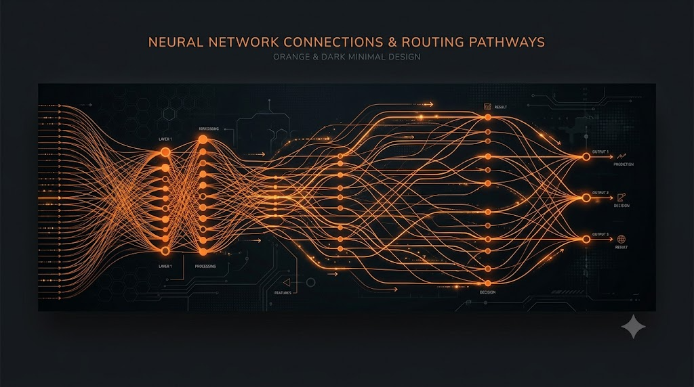

<p align="center">
  
</p>

# @monoes/routing

[](https://www.npmjs.com/package/@monoes/routing)
[](https://github.com/monoes/monomind/blob/main/LICENSE)
[](https://nodejs.org)

> **Semantic task-to-agent routing** for Monomind (`@monoes/routing` `v2.24.0` / Monomind CLI `v2.29.1`).

Part of the [Monomind](https://github.com/monoes/monomind) ecosystem. Handles deterministic keyword filtering, hash-embedding cosine similarity matching, and LLM fallback classification to route user tasks to specialized agent roles.

---

## 🏗 Task-to-Agent Cascade Architecture

When a task description is processed, `@monoes/routing` executes a multi-tier cascade flow (fast deterministic $\rightarrow$ embedding similarity $\rightarrow$ LLM fallback):

```
                       Task Description
                              │
                              ▼
                ┌───────────────────────────┐
                │ Tier 1: Keyword Pre-Filter │ ── Match ──▶ confidence: 1.0 (method: 'keyword')
                │ (24 rules, < 1ms)         │
                └───────────────────────────┘
                              │ No Match
                              ▼
                ┌───────────────────────────┐
                │ Tier 2: Cosine Centroid   │ ── Sim >= 0.5 ──▶ confidence: cosine (method: 'semantic')
                │ (256-D MD5/HNSW Vector)   │
                └───────────────────────────┘
                              │ Below Threshold
                              ▼
                ┌───────────────────────────┐
                │ Tier 3: LLM Fallback      │ ── Classify ──▶ confidence: 0.85 (method: 'llm_fallback')
                │ (Claude Haiku / Degraded) │
                └───────────────────────────┘
```

### 1. Tier 1: Deterministic Keyword Pre-Filter
- **Source**: [`keyword-pre-filter.ts`](src/keyword-pre-filter.ts)
- Evaluates tasks using fast regular expression matching against 24 default rule definitions (e.g., CVE security checks, unit test files, Docker/DevOps configs, Solidity contracts, MCP tools). Every rule and route names a spawnable agent — a bundled agent's frontmatter `name`, such as `Security Engineer`.
- Returns immediate match with `confidence: 1.0` and `method: 'keyword'`.

### 2. Tier 2: Cosine Centroid Embedding Match
- **Source**: [`route-layer.ts`](src/route-layer.ts), [`cosine.ts`](src/cosine.ts)
- Computes cosine similarity between task vector embeddings and agent route centroid vectors.
- Supports lightweight 256-D MD5/SHA-256 hash embeddings (`LocalEncoder`) or transformer embeddings (`HNSWEncoder`).
- If similarity $\ge \text{threshold}$ (default: 0.5), routes task with `method: 'semantic'`.

### 3. Tier 3: LLM Fallback Classification
- **Source**: [`llm-fallback.ts`](src/llm-fallback.ts), [`prompts/classify.ts`](src/prompts/classify.ts)
- Constructs a compact capability prompt (max 8,000 chars) detailing candidate agent descriptions and returns classification with `confidence: 0.85` and `method: 'llm_fallback'`.
- On API failure or missing key, degrades gracefully to the nearest semantic match with `method: 'semantic_degraded'`.

---

## 💻 CLI Command Reference (`monomind route`)

The Monomind CLI provides 9 subcommands under `monomind route` (defined in [`packages/@monomind/cli/src/commands/route.ts`](../cli/src/commands/route.ts) and its `route-*-commands.ts` siblings). `task`, `list-agents`, `stats` and the outcome commands go through the central picker (the same ranking as `monomind pick`); only `semantic` (deprecated) runs the `@monoes/routing` pipeline.

| Subcommand | Usage | Description | Key Flags |
|---|---|---|---|
| `task` | `monomind route task "<prompt>"` | Primary CLI entry point (also `monomind route "<prompt>"`). Routes a task prompt to the best agent. | `-a/--agent`, `-j/--json` |
| `semantic` (`sem`) | `monomind route semantic -t "<prompt>"` | Deprecated: central picker, then cosine similarity (`RouteLayer`) and Haiku fallback. | `-t/--task`, `-d/--debug`, `-j/--json` |
| `list-agents` (`agents`, `ls`) | `monomind route list-agents` | Lists available agent types. | `-j/--json` |
| `stats` | `monomind route stats` | Shows routing accuracy and adherence. | `-j/--json` |
| `feedback` | `monomind route feedback -t "<task>" -a <agent> -r <reward>` | Records routing outcome to the local feedback ledger (`route-outcomes.jsonl`). | `-t`, `-a`, `-r` (-1 to 1), `-n/--next-task` |
| `reset` | `monomind route reset` | Clears outcome history. | `-f/--force` |
| `export` | `monomind route export -f <file>` | Exports route outcomes (stdout when `-f` is omitted). | `-f/--file` |
| `import` | `monomind route import -f <file>` | Imports route outcomes from a file. | `-f/--file` |
| `coverage` (`cov`) | `monomind route coverage` | Routes tasks based on test coverage analysis. | `-p/--path`, `-t/--threshold` (default 80), `-s/--suggest`, `-g/--gaps`, `-j/--json` |

---

## ⚡ Task Complexity Scoring Rules

The `hooks_route` and `hooks_pre-task` MCP tools estimate effort from the task wording ([`taskComplexity` in `hooks-route.ts`](../cli/src/mcp-tools/hooks-route.ts)):

- `High` (estimated 2-4 hours): task description contains `'complex'` or `'architecture'`, or is longer than 200 characters.
- `Low` (estimated 10-30 min): task description contains `'simple'` or `'fix'`, or is shorter than 50 characters.
- `Medium` (estimated 30-60 min): everything else.

---

## Test Suites

Vitest test suites are located in [`packages/@monomind/routing/src/__tests__/`](src/__tests__/):
- `route-layer.test.ts`: Cascade evaluation, thresholds, and fallback behavior.
- `keyword-pre-filter.test.ts`: Regex rule precedence and pattern matching.
- `encoder.test.ts`: 256-D MD5/SHA-256 local encoding and LRU cache eviction.
- `llm-fallback.test.ts`: LLM prompt construction, candidate hint parsing, and error recovery.
- `cosine.test.ts`: Validates vector dot product calculation and centroid position aggregation.
- `classify-prompt.test.ts`: Classification prompt output.
- `agent-slugs.test.ts`: Route and keyword rule agent slugs resolve to spawnable agents.
- `capability-index.test.ts`: Ensures agent capability indexing stays under the 8,000-character context budget.

Run unit tests via:
```bash
pnpm --filter @monoes/routing test
```

---

## 🚀 Usage Example

```typescript
import { RouteLayer } from '@monoes/routing';

const router = new RouteLayer({
  routes: [
    { name: 'coder', agentSlug: 'coder', utterances: ['implement feature', 'build api'], threshold: 0.5, fallbackToLLM: false },
    { name: 'tester', agentSlug: 'tester', utterances: ['write unit test', 'add coverage'], threshold: 0.5, fallbackToLLM: false },
    { name: 'security', agentSlug: 'Security Engineer', utterances: ['fix cve', 'audit vulnerability'], threshold: 0.5, fallbackToLLM: false },
  ],
  enableKeywordFilter: true,
});

await router.initialize();

// Tier 1 Match (<1ms)
const res1 = await router.route('Fix CVE-2024-12345 vulnerability');
// { agentSlug: 'Security Engineer', confidence: 1.0, method: 'keyword' }

// Tier 2 Match (Embedding Centroid)
const res2 = await router.route('Create new REST endpoint for user profiles');
// { agentSlug: 'coder', confidence: 0.82, method: 'semantic' }
```

---

## 🔗 Links

- [GitHub Repository](https://github.com/monoes/monomind)
- [Documentation Site](https://monoes.github.io/monomind/)
- [Monomind CLI Command Reference](https://monoes.github.io/monomind/#routing)

## 📄 License

Apache-2.0

